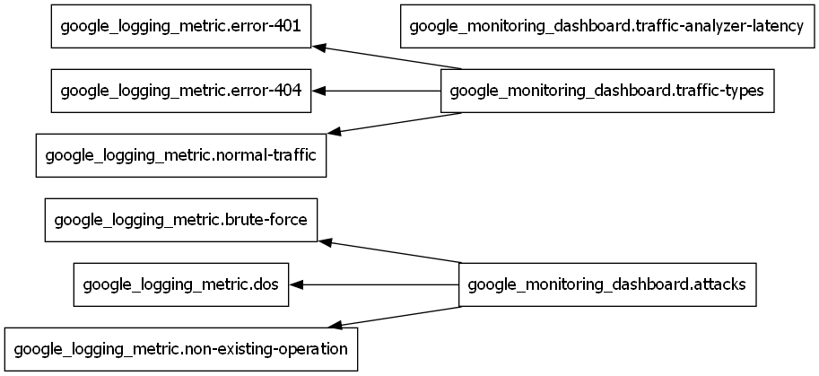

# Dashboards Module

A Dashboards Module, featuring two logs based metrics dashboards - one for traffic types and their volumes, and the other for attacks monitoring. It also includes a dashboard for latency monitoring.

## Dependency Diagram

<!-- Beginning of terraform docs generated content -->

## Requirements

| Name | Version |
| ---- | ------- |
|  [google](#requirement\_google) | >= 5.0.0 |

## Providers

| Name | Version |
| ---- | ------- |
|  [google](#provider\_google) | >= 5.0.0 |

## Modules

No modules.

## Resources

| Name | Type |
| ---- | ---- |
| [google_logging_metric.brute-force](https://registry.terraform.io/providers/hashicorp/google/latest/docs/resources/logging_metric) | resource |
| [google_logging_metric.dos](https://registry.terraform.io/providers/hashicorp/google/latest/docs/resources/logging_metric) | resource |
| [google_logging_metric.error-401](https://registry.terraform.io/providers/hashicorp/google/latest/docs/resources/logging_metric) | resource |
| [google_logging_metric.error-404](https://registry.terraform.io/providers/hashicorp/google/latest/docs/resources/logging_metric) | resource |
| [google_logging_metric.non-existing-operation](https://registry.terraform.io/providers/hashicorp/google/latest/docs/resources/logging_metric) | resource |
| [google_logging_metric.normal-traffic](https://registry.terraform.io/providers/hashicorp/google/latest/docs/resources/logging_metric) | resource |
| [google_monitoring_dashboard.attacks](https://registry.terraform.io/providers/hashicorp/google/latest/docs/resources/monitoring_dashboard) | resource |
| [google_monitoring_dashboard.traffic-analyzer-latency](https://registry.terraform.io/providers/hashicorp/google/latest/docs/resources/monitoring_dashboard) | resource |
| [google_monitoring_dashboard.traffic-types](https://registry.terraform.io/providers/hashicorp/google/latest/docs/resources/monitoring_dashboard) | resource |

## Inputs

| Name | Description | Type | Default | Required |
| ---- | ----------- | ---- | ------- | :------: |
|  [gcp-project](#input\_gcp-project) | your project ID (e.g., my-gcp-project-123) | `string` | n/a | yes |
|  [gcp-region](#input\_gcp-region) | the GCP region (e.g., us-central1) | `string` | n/a | yes |

## Outputs

No outputs.

<!-- End of terraform docs generated content -->