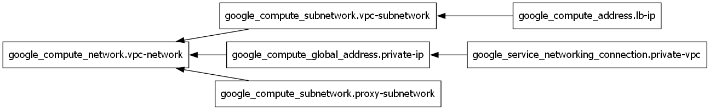

# Network Module
A Network Module, including VPC Network, VPC Subnetwork, Proxy Subnetwork, Load Balancer's IP and more.

## Dependency Diagram

<!-- Beginning of terraform docs generated content -->

## Requirements

| Name | Version |
| ---- | ------- |
|  [google](#requirement\_google) | >= 5.0.0 |
|  [google-beta](#requirement\_google-beta) | >= 6.50.0 |

## Providers

| Name | Version |
| ---- | ------- |
|  [google](#provider\_google) | >= 5.0.0 |
|  [google-beta](#provider\_google-beta) | >= 6.50.0 |

## Modules

No modules.

## Resources

| Name | Type |
| ---- | ---- |
| [google-beta_google_compute_subnetwork.proxy-subnetwork](https://registry.terraform.io/providers/hashicorp/google-beta/latest/docs/resources/google_compute_subnetwork) | resource |
| [google_compute_address.lb-ip](https://registry.terraform.io/providers/hashicorp/google/latest/docs/resources/compute_address) | resource |
| [google_compute_global_address.private-ip](https://registry.terraform.io/providers/hashicorp/google/latest/docs/resources/compute_global_address) | resource |
| [google_compute_network.vpc-network](https://registry.terraform.io/providers/hashicorp/google/latest/docs/resources/compute_network) | resource |
| [google_compute_subnetwork.vpc-subnetwork](https://registry.terraform.io/providers/hashicorp/google/latest/docs/resources/compute_subnetwork) | resource |
| [google_service_networking_connection.private-vpc](https://registry.terraform.io/providers/hashicorp/google/latest/docs/resources/service_networking_connection) | resource |

## Inputs

| Name | Description | Type | Default | Required |
| ---- | ----------- | ---- | ------- | :------: |
|  [gcp-project](#input\_gcp-project) | your project ID (e.g., my-gcp-project-123) | `string` | n/a | yes |
|  [gcp-region](#input\_gcp-region) | the GCP region (e.g., us-central1) | `string` | n/a | yes |

## Outputs

| Name | Description |
| ---- | ----------- |
|  [ip-range](#output\_ip-range) | the name of the allocated internal IP range reserved for VPC peering |
|  [lb-ip](#output\_lb-ip) | load balancer's external IP address |
|  [network-id](#output\_network-id) | the ID of the network |
|  [proxy-subnetwork-id](#output\_proxy-subnetwork-id) | the ID of the proxy subnetwork |
|  [subnetwork-id](#output\_subnetwork-id) | the ID of the subnetwork |

<!-- End of terraform docs generated content -->