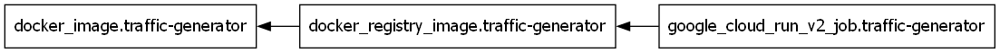

# Traffic generator
A module deploying the [generator app](https://github.com/juliamikolajczyk/traffic-simulation-and-monitoring-system/tree/main/generator) into the GCP cloud as a scalable Cloud Run Job.

## Dependency Diagram

<!-- Beginning of terraform docs generated content -->

## Requirements

| Name | Version |
| ---- | ------- |
|  [docker](#requirement\_docker) | 4.5.0 |
|  [google](#requirement\_google) | >= 5.0.0 |
|  [google-beta](#requirement\_google-beta) | >= 6.50.0 |

## Providers

| Name | Version |
| ---- | ------- |
|  [docker](#provider\_docker) | 4.5.0 |
|  [google-beta](#provider\_google-beta) | >= 6.50.0 |

## Modules

No modules.

## Resources

| Name | Type |
| ---- | ---- |
| [docker_image.traffic-generator](https://registry.terraform.io/providers/kreuzwerker/docker/4.5.0/docs/resources/image) | resource |
| [docker_registry_image.traffic-generator](https://registry.terraform.io/providers/kreuzwerker/docker/4.5.0/docs/resources/registry_image) | resource |
| [google-beta_google_cloud_run_v2_job.traffic-generator](https://registry.terraform.io/providers/hashicorp/google-beta/latest/docs/resources/google_cloud_run_v2_job) | resource |

## Inputs

| Name | Description | Type | Default | Required |
| ---- | ----------- | ---- | ------- | :------: |
|  [analyzer-uri](#input\_analyzer-uri) | traffic analyzer's URI | `string` | n/a | yes |
|  [exec-time](#input\_exec-time) | for how many seconds the traffic is generated (e.g., 3400); must be less than or equal to 604715 | `number` | `600` | no |
|  [gcp-project](#input\_gcp-project) | your project ID (e.g., my-gcp-project-123) | `string` | n/a | yes |
|  [gcp-region](#input\_gcp-region) | the GCP region (e.g., us-central1) | `string` | n/a | yes |
|  [gcp-repository](#input\_gcp-repository) | the ID of the registry repository | `string` | n/a | yes |
|  [generator-cpu](#input\_generator-cpu) | the number of CPU cores allocated to each generator instance | `string` | `"2"` | no |
|  [generator-memory](#input\_generator-memory) | the amount of RAM allocated to each generator instance | `string` | `"2Gi"` | no |
|  [generator-parallelism](#input\_generator-parallelism) | the maximum number of tasks that can be run at the exact same time | `number` | `10` | no |
|  [generator-task-count](#input\_generator-task-count) | the total number of generator instances that need to be run to complete the job | `number` | `5` | no |
|  [generator-user-count](#input\_generator-user-count) | the number of users generating traffic from an instance | `string` | `"5"` | no |
|  [lb-ip](#input\_lb-ip) | load balancer's external IP address | `string` | n/a | yes |
|  [network-id](#input\_network-id) | the ID of the network | `string` | n/a | yes |
|  [subnetwork-id](#input\_subnetwork-id) | the ID of the subnetwork | `string` | n/a | yes |

## Outputs

No outputs.

<!-- End of terraform docs generated content -->